# Graph: Are the Chief Election Commissioner and the Union government working together to make India's elections unfair?

Artifact `bf4bff4f5367`. Green stands, grey falls, amber is open. Solid arrows argue for a part, dotted arrows against it, thick arrows are attacks.

## K1. Under the 2023 law, the government side holds a majority on the panel that picks Election Commissioners.

*Fact · supported*

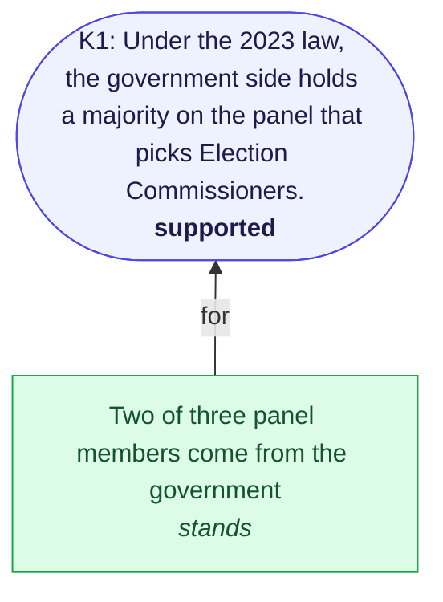

## K2. The 2023 law made the Election Commission less independent than before.

*Meaning · contested*

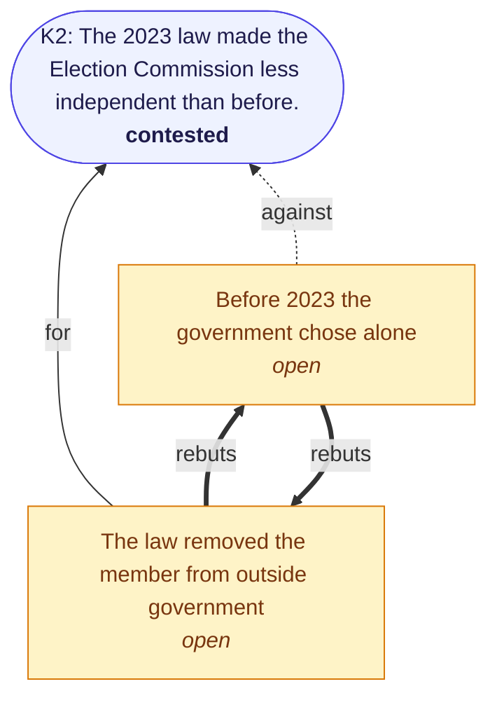

## K3. Bihar's 2025 roll revision (SIR) removed tens of lakhs of names.

*Fact · supported*

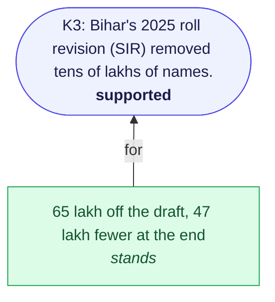

## K4. The Bihar SIR left out many eligible voters.

*Meaning · contested*

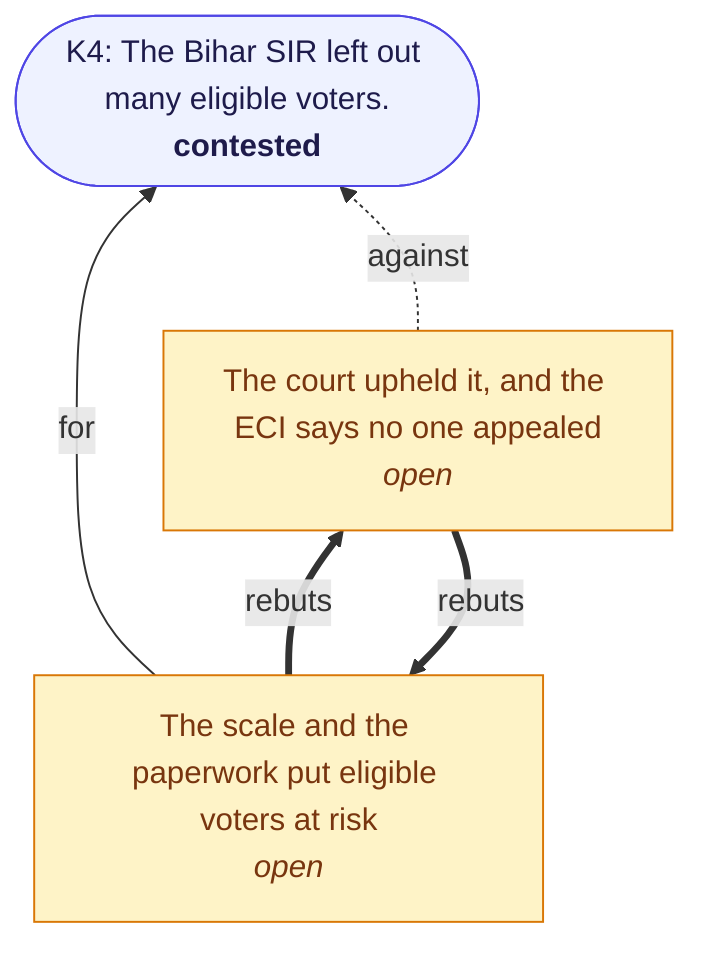

## K5. There was an organised attempt to fraudulently delete voters in Aland, Karnataka.

*Fact · supported*

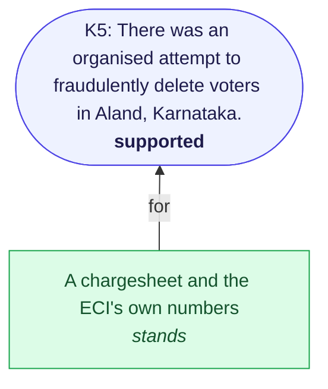

## K6. The ECI held back data that investigators needed in the Aland case.

*Meaning · contested*

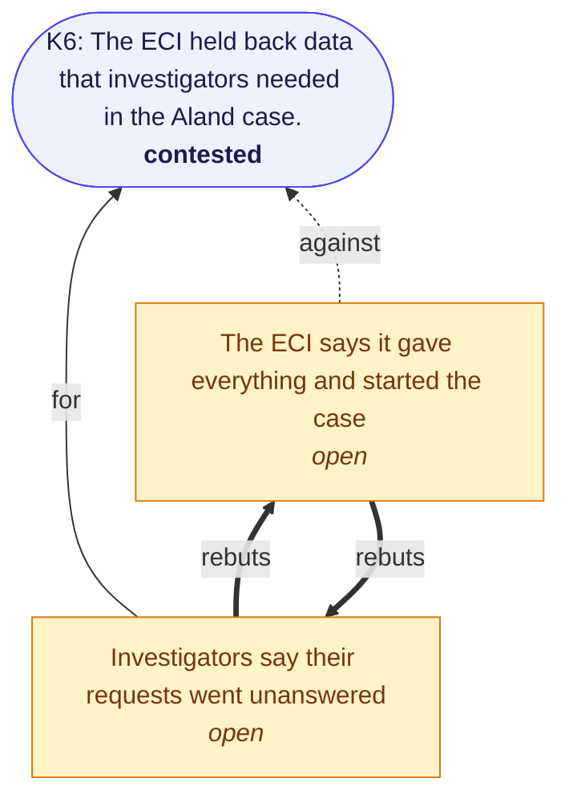

## K7. Voter rolls in Mahadevapura and Maharashtra were padded with fake or duplicate entries.

*Meaning · contested*

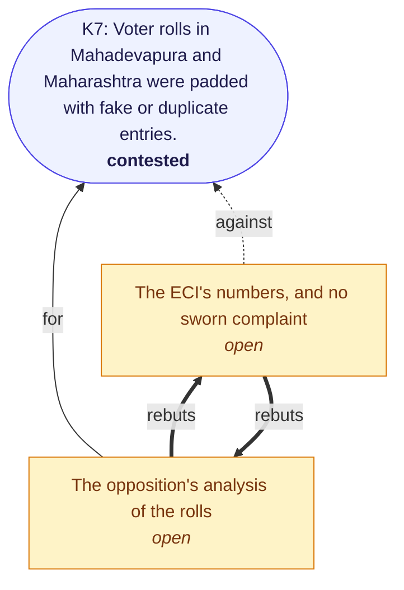

## K8. Voting machines (EVMs) have been tampered with to change results.

*Meaning · challenged*

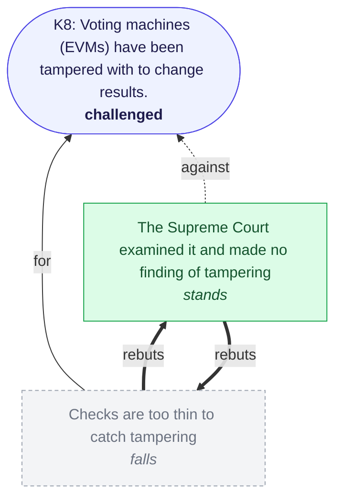

## K9. The ECI enforces the Model Code of Conduct more softly against the ruling party.

*Meaning · contested*

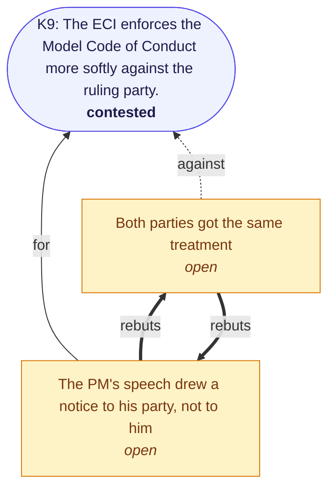

## K10. Since late 2024, public access to election records and polling footage has been narrowed.

*Fact · supported*

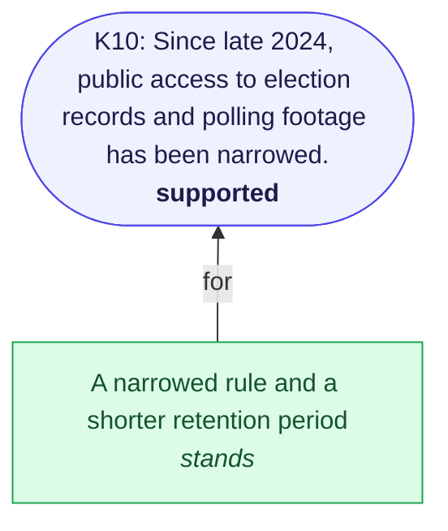

## K11. Inside the ECI, the Chief Election Commissioner has taken decisions over the objections of the other two commissioners.

*Meaning · contested*

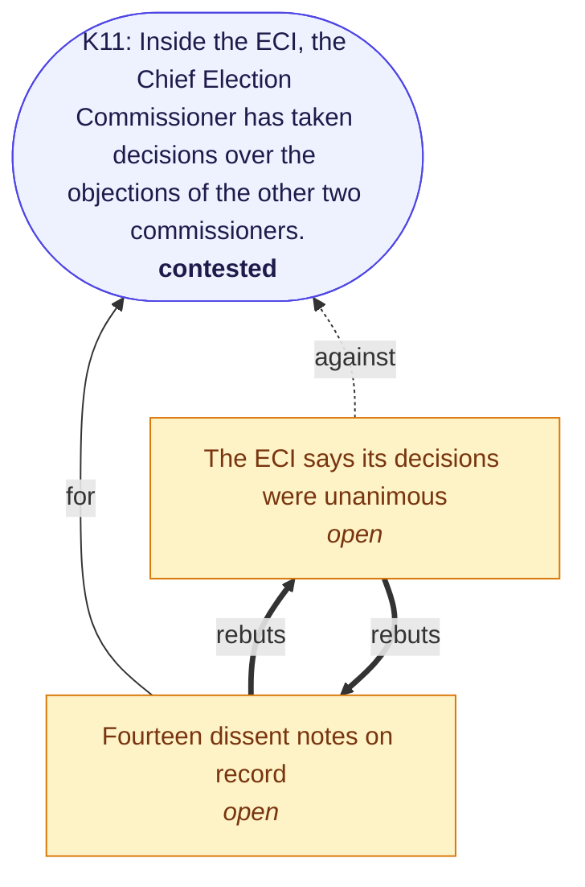

## K12. The CEC and the Union government are acting together to tilt elections toward the ruling party.

*Intent · unproven either way*

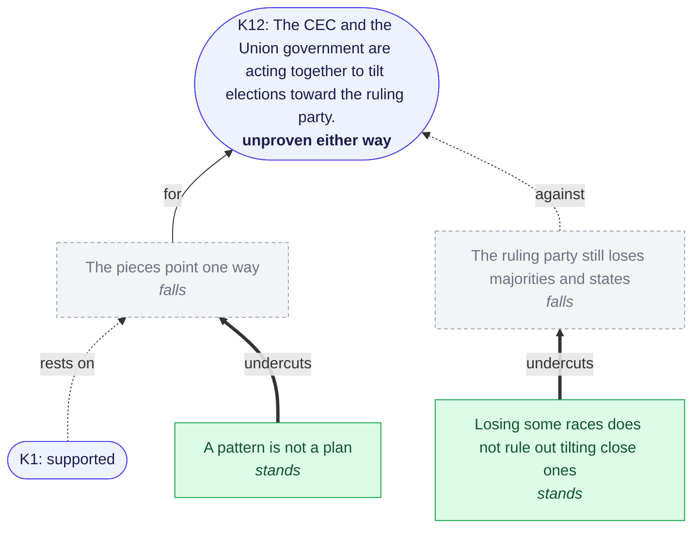
